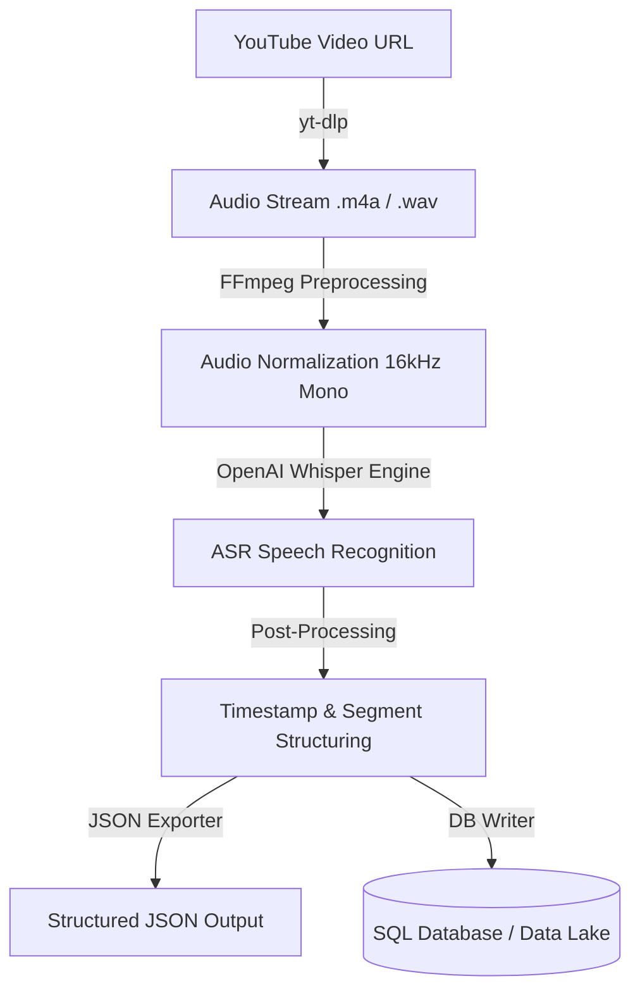

# YouTube Speech-to-Text Data Pipeline

An automated, end-to-end speech-to-text data pipeline leveraging `yt-dlp`, `FFmpeg`, and OpenAI Whisper. Designed for robust audio stream extraction, signal normalization, and structured transcript generation suitable for downstream NLP tasks and database storage.

---

## 🏗️ System Architecture



---

## ⚙️ Setup & Installation Guide

### System Dependencies (Linux)
```bash
sudo apt update
sudo apt install -y ffmpeg python3-pip python3-venv git
```

### Environment Setup
```bash
# Clone repository
git clone [https://github.com/Dmitrizakanilov279/youtube-whisper-pipeline.git](https://github.com/Dmitrizakanilov279/youtube-whisper-pipeline.git)
cd youtube-whisper-pipeline

# Create and activate virtual environment
python3 -m venv venv
source venv/bin/activate

# Install dependencies
pip install --upgrade pip
pip install -r requirements.txt
```

---

## 💻 Execution & Sample Output

### Command Execution
```bash
python main.py --url "[https://www.youtube.com/watch?v=EXAMPLE_ID](https://www.youtube.com/watch?v=EXAMPLE_ID)" --model "medium" --output_dir "./outputs"
```

### Sample Output Schema (`outputs/transcript.json`)
```json
{
  "metadata": {
    "video_id": "EXAMPLE_ID",
    "duration_seconds": 312.5,
    "model_used": "medium",
    "processed_at": "2026-10-31T08:00:00Z"
  },
  "segments": [
    {
      "id": 1,
      "start": 0.00,
      "end": 4.20,
      "text": "Welcome to the systems and infrastructure architecture overview."
    }
  ]
}
```
